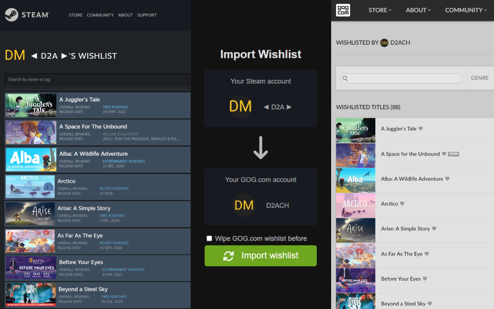

### Terrible Vibecoded AI Slop Edition!
##Someone please fix this extension properly!

This is a chrome extension that helps you to import your Steam wishlist to your GOG.com account. Originally by Daniel Mandes. "Fixed" by me using Google AI Studio because the original is broken and Mendes is MIA.

## Installation

I don't have a Chrome Web Store developer account and probably never will, so you'll have to manually sideload this.

## AI Disclosure
The original version of this extension, by Daniel Mendes, has not been updated for three years and doesn't work any more. This is a stopgap which I vibecoded using Google AI Studio in about an hour out of pure irritation. I am not a coder, nor do I consider myself a developer, and I do not consider this a "proper" fix as such. I welcome and encourage any and all attempts by people with more coding knowledge than me to do this more cleanly without using AI. AI is a tool, not a replacement for human talent, and vibecoding is for losers such as myself.
